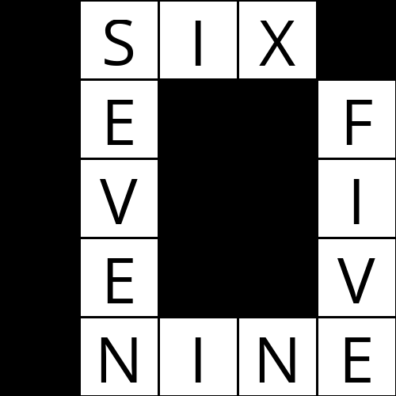

# Crossword Generator

Give it an empty crossword grid and a list of words, and it fills the grid so every across and down word fits.



## How it works

Filling a crossword is a **constraint satisfaction problem**:
- each slot in the grid is a *variable*
- the possible words for a slot are its *domain*
- the *constraints* are that each word has the right length, no word is used twice, and crossing words share the same letter where they overlap

The solver uses:
- **Node consistency** to drop any word of the wrong length up front
- **The AC-3 algorithm** to remove words that cannot match any word in a crossing slot
- **Backtracking search** with interleaved arc consistency, re-running AC-3 after each guess and undoing domain changes when a branch fails
- **Heuristics** to find solutions faster:
  - *Minimum remaining values*: fill the most constrained slot first, breaking ties by most neighbors
  - *Least constraining value*: try the word that rules out the fewest options for neighboring slots first

## Run it

```bash
pip install pillow
python generate.py data/structure1.txt data/words1.txt            # print in terminal
python generate.py data/structure1.txt data/words1.txt out.png    # also save an image
```

Grid files use `_` for fillable cells and `#` for blocked cells. Word files have one word per line. Try the different `structure*` / `words*` combinations. If a grid can't be filled, the program prints "No solution."

## Built with

Python · Pillow
